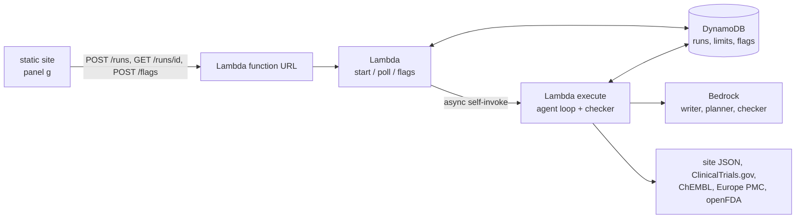

# Architecture

Trial Radar is a scheduled batch pipeline that publishes static JSON, plus a static web app that reads it. There is no server and no database service: GitHub Actions runs the pipeline, a `data` branch holds the Parquet history, GitHub Releases hold the raw snapshots, and GitHub Pages serves the site.

```mermaid
flowchart LR
    CT[ClinicalTrials.gov API v2] -->|paginate, retry, de-duplicate| FETCH[fetch all studies]
    FETCH --> STAGE[stage raw snapshot<br/>raw/.incoming/]
    STAGE --> SCHEMA{raw schema check}
    SCHEMA -->|errors| QUAR[quarantine as *.failed.*<br/>failed run_log row]
    SCHEMA --> REL[relevance filter<br/>conditions + keywords + MeSH]
    REL --> NORM[normalize to tables<br/>trial, condition, intervention,<br/>sponsor, site, outcome]
    NORM --> QC{quality gate}
    QC -->|errors| QUAR
    QC --> DIFF[tracked state + diff<br/>vs previous day]
    DIFF --> STORE[(store: current/, previous/,<br/>history/*.parquet)]
    STORE --> PROMOTE[promote raw snapshot<br/>raw/YYYY-MM-DD.jsonl.gz]
    PROMOTE --> EXPL[explorer stage<br/>features, UMAP layout, outcome labels,<br/>neighbourhood statistic]
    EXPL --> RISK[stop_risk stage<br/>score running trials, optional R19]
    RISK --> EXPORT[export site JSON<br/>changes, trials, meta, explorer, risk]
    EXPORT --> COORDS[(save explorer/coords.parquet)]
    COORDS --> LOG[run_log: success]
    LOG --> DATA[(data branch<br/>orphan commit)]
    LOG --> REL2[(monthly release<br/>snapshots-YYYY-MM)]
    EXPORT --> WEB[Vite build] --> PAGES[GitHub Pages]
```

## Explorer stage

After the store write and snapshot promotion, and before export, `pipeline._explorer` builds the Explore map (`trialradar.explorer.build.build_explorer`) in its own logged stage:

1. `extras` reads fields the normalized tables do not carry (summary, eligibility, arm groups, whether results are posted) straight from the raw study. A study whose fields are malformed there gets empty extras and an `extras_fallback` warning; it never fails the run.
2. `drugs` cleans experimental-arm drug names (salts, doses and placebo-like terms removed, aliases applied); `outcomes` derives the success proxy and pool eligibility; `features` builds content-only vectors (disease, treatment type, molecule, population); `layout` runs a seeded UMAP and aligns it to the previous day's layout; `stats` computes the neighbourhood statistic over the pool (finished trials that could succeed, with an experimental drug) and a one-sided p-value from 10,000 label shuffles (`clustered` only when p < 0.025).
3. The previous layout is read from `data/explorer/coords.parquet` (missing means first run) and the new one is saved there after a successful export, so dots stay put from day to day.
4. The result is written to the site as `explorer.json`. Trial files gain `brief_summary`, `eligibility` and `has_results`.

Unlike the export, a failed explorer build does not fail the run: it becomes an `explorer:` run warning, the site is exported without `explorer.json` (a stale one is removed, so the page says the map appears after the next daily update) and the saved coordinates are kept. A UMAP failure that falls back to a flat layout is an `explorer_layout_fallback:` warning. `rebuild` runs the same stage for the final day, with the same handling.

## Stop-risk stage

After the pipeline figure and mechanism graph and before export, `pipeline._stop_risk` (`trialradar.risk.apply`) scores the running drug and biologic trials of phase 1 to 3 with the committed model and writes `risk.json`: per-trial estimate, range, typical rate and up to three factors (omitted when `risk.per_trial` is false), the `not_scored` reasons, per-target and per-target-by-disease summaries, and the model block (version, refit window). The stage is optional (R19): a missing or mismatched artefact, a scikit-learn minor version other than the card's, or any other failure becomes one `stop_risk:` run warning, the site is exported without `risk.json` (a stale one is removed) and the web shows "Estimates appear after the next daily update". `rebuild` runs it for the final day.

Training is never part of the run. `pipeline/scripts/train_stop_risk.py` is run by hand with network access: it pulls finished trials year by year into a cache, fits the baseline and the calibrated boosted ensembles, applies the ship rule (boosted ships only if AUC is 0.02 higher and Brier no worse), and writes the committed artefacts to `config/risk/`: `model.joblib` (about 7 MB), `card.json` (metrics, filter, features, exclusions, typical rates), `heldout.parquet`, `sponsor_history.csv`; `factor_labels.csv` is hand-kept. `tests/unit/test_risk_card.py` reloads the model and recomputes the card's numbers. See `config/risk/README.md`.

## Diligence agent backend

The one place outside the static model: an optional backend for the target page's diligence panel. The site works without it (recorded runs, or "offline"). `agent/template.yaml` describes it; Martin deploys it, CI never does.

A start request is validated, checked against the daily caps (set in `agent/config.yaml`; IPs kept only as salted hashes) and answered with a run id; the same request in flight returns the same id. The execute invocation runs the tool loop within the per-run limits and the checker, and writes the run record that polling reads. CI replays recorded runs without any model or network (`agent/tests/test_eval_replay.py`); the prompt hash gate fails with "re-record the evaluation".

## Principles

- **Bad data never replaces good data.** A failed run leaves state, history and the site as they were. The raw snapshot is staged first and promoted only after the store write succeeds; data failures are quarantined as `*.failed.*`, which is never uploaded or replayed.
- **Raw snapshots are the source of truth.** They hold every fetched study. `trialradar rebuild` (download the `snapshots-YYYY-MM` release assets into `raw/` first, e.g. `gh release download <tag> --dir raw`) replays them in date order and reproduces the same history, so relevance, alias or threshold changes can be applied retroactively.
- **The data branch is the commit point.** `daily.yml` uploads the raw snapshot and deploys the site first and force-pushes the `data` branch last, so a failure anywhere earlier leaves the stored state unchanged and the next run redoes the same registry version instead of skipping a day that never shipped.
- **A run is idempotent per day.** Re-running a day replaces that day's change and snapshot rows. `run_log` is append-only.
- **Change detection is alias-stable.** Both sides of a comparison are derived from stored raw names with the current aliases, so editing an alias file never produces change rows.
- **A new area is a config change.** Nothing under `pipeline/src` or `web/src` names a condition; a test enforces it.

## Modules (`pipeline/src/trialradar`)

| Module | Role |
|---|---|
| `config` | Validated `AreaConfig` loaded from `config/area.yaml` |
| `ctgov/query`, `ctgov/client` | Query building; paginated, retrying API client |
| `relevance` | Whole-phrase match of conditions, keywords and MeSH terms against configured synonyms |
| `normalize`, `textnorm`, `tables` | Raw study JSON to typed Polars tables; text and alias normalisation |
| `tracked`, `diff` | Tracked-field state per trial; field-level changes with notable flags |
| `quality` | Raw schema, null-rate, date-order, duplicate and row-drop checks |
| `snapshot`, `store` | Raw snapshot staging/promotion; crash-safe Parquet store |
| `explorer/*` | Map data: `extras`, `drugs`, `outcomes`, `features`, `layout`, `stats`, `build` (see Explorer stage) |
| `risk/scope`, `risk/fields`, `risk/features` | Which trials are covered and labelled; raw fields; the start-time feature frame |
| `risk/model`, `risk/evaluate` | Baseline logistic and calibrated boosted recipes, bootstrap ensemble; AUC, Brier, calibration |
| `risk/sponsors`, `risk/explain` | Sponsor track record (point-in-time in training); contributions and plain-words factors |
| `risk/artefacts`, `risk/apply` | Save and load of `config/risk/`; the daily scoring that builds `risk.json` |
| `export` | Site JSON: `changes/{1,7,30}d.json`, `trials/<NCT>.json`, `trials.json` (browse index), `meta.json`, `explorer.json`, `pipeline.json`, `mechanisms.json`, `risk.json` |
| `pipeline`, `cli` | Orchestration, `rebuild`, `trialradar run`, `check`, `rebuild` |

## Workflows

- `ci.yml`: ruff, mypy, pytest, pip-audit (pipeline); lint, tsc, vitest, npm audit, Playwright (web).
- `daily.yml`: 07:17 UTC. Runs the pipeline; only on `status=success` it uploads the raw snapshot, deploys Pages and finally pushes the data branch. A failed `data` checkout stops the job; only a missing branch counts as a first run. Failure evidence is uploaded as an Actions artifact.
- `live-check.yml`: weekly contract check against the real API.
- `record-fixtures.yml`: manual; records real API fixtures for tests.
