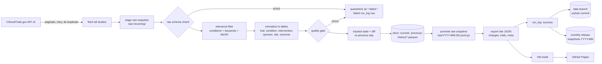

# Architecture

Trial Radar is a scheduled batch pipeline that publishes static JSON, plus a static web app that reads it. There is no server and no database service: GitHub Actions runs the pipeline, a `data` branch holds the Parquet history, GitHub Releases hold the raw snapshots, and GitHub Pages serves the site.

## Principles

- **Bad data never replaces good data.** A failed run leaves state, history and the site as they were. The raw snapshot is staged first and promoted only after the store write succeeds; data failures are quarantined as `*.failed.*`, which is never uploaded or replayed.
- **Raw snapshots are the source of truth.** They hold every fetched study. `trialradar rebuild` (download the `snapshots-YYYY-MM` release assets into `raw/` first, e.g. `gh release download <tag> --dir raw`) replays them in date order and reproduces the same history, so relevance, alias or threshold changes can be applied retroactively.
- **The data branch is the commit point.** `daily.yml` uploads the raw snapshot and deploys the site first and force-pushes the `data` branch last, so a failure anywhere earlier leaves the stored state unchanged and the next run redoes the same registry version instead of skipping a day that never shipped.
- **A run is idempotent per day.** Re-running a day replaces that day's change and snapshot rows. `run_log` is append-only.
- **Change detection is alias-stable.** Both sides of a comparison are derived from stored raw names with the current aliases, so editing an alias file never produces change rows.
- **A new area is a config change.** Nothing under `pipeline/src` or `web/src` names a condition; a test enforces it.

## Modules (`pipeline/src/trialradar`)

| Module | Role |
|---|---|
| `config` | Validated `AreaConfig` loaded from `config/area.yaml` |
| `ctgov/query`, `ctgov/client` | Query building; paginated, retrying API client |
| `relevance` | Whole-phrase match of conditions, keywords and MeSH terms against configured synonyms |
| `normalize`, `textnorm`, `tables` | Raw study JSON to typed Polars tables; text and alias normalisation |
| `tracked`, `diff` | Tracked-field state per trial; field-level changes with notable flags |
| `quality` | Raw schema, null-rate, date-order, duplicate and row-drop checks |
| `snapshot`, `store` | Raw snapshot staging/promotion; crash-safe Parquet store |
| `export` | Site JSON: `changes/{1,7,30}d.json`, `trials/<NCT>.json`, `trials.json` (browse index), `meta.json` |
| `pipeline`, `cli` | Orchestration, `rebuild`, `trialradar run`, `check`, `rebuild` |

## Workflows

- `ci.yml`: ruff, mypy, pytest, pip-audit (pipeline); lint, tsc, vitest, npm audit, Playwright (web).
- `daily.yml`: 07:17 UTC. Runs the pipeline; only on `status=success` it uploads the raw snapshot, deploys Pages and finally pushes the data branch. A failed `data` checkout stops the job; only a missing branch counts as a first run. Failure evidence is uploaded as an Actions artifact.
- `live-check.yml`: weekly contract check against the real API.
- `record-fixtures.yml`: manual; records real API fixtures for tests.
